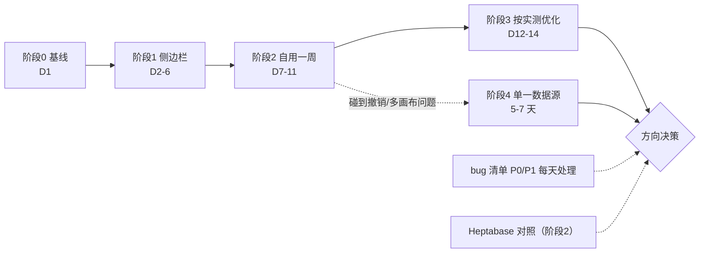

# GhostBoard 整改方案（slim/v1 质量冲刺）

> 基线：`slim/v1` 分支 `98d3a5a`（2026-11-04）。周期约 2 周，之后做方向决策。
> 原则：**这期间不加新功能、不再调整产品结构**，除非本方案里写了。每个阶段单独提交，都有验收标准，不达标就不进下一阶段。
>
> 2026-11-04 评审后调整了顺序：先做侧边栏，再自用一周，其余按实测决定。原方案的“单一数据源”（现阶段 4）改为视自用结果而定。

## 为什么改交互

卡片打开时从画布形变到全屏，文字要在两种字号、两种排版之间过渡，在 WebKit 下怎么调都做不到无缝（多轮尝试的记录 focus-transition-variants.md 已随阶段 1 删除，可在 git 历史中查看）。这是自用中最大的阻断点，符合 PRD-slim §6“新需求必须来自真实阻断点”的要求。

改成右侧边栏后：只需滑入一块面板、只动 `transform`，容易做顺；画布不被挡住，可以边看素材边写。

**从现在起，转场动画代码不再投入**，只修 P0/P1，阶段 1 整体删除。

## 已确认的交互决定（2026-11-04）

| # | 问题 | 决定 |
| --- | --- | --- |
| 1 | 卡片怎么打开侧边栏：单击还是双击 / `Enter`？ | **单击只选中，双击或 `Enter` 打开**。拖拽、框选时不会误开，跟 Heptabase 的手感接近。现在是单击直接聚焦 |
| 2 | 侧边栏是**盖在**画布上面，还是把画布**挤窄**？ | **盖在上面，不加遮罩，画布照常可操作**。打开时如果所选卡片被侧边栏挡住，就把画布自动平移一下。挤窄会让 React Flow 反复重新计算尺寸，更容易卡 |
| 3 | 图片要不要保留全屏看大图？ | 保留，但只用淡入，**不做形变动画** |
| 4 | 要不要保留"全屏写作"？ | 保留，作为侧边栏上的一个按钮，打开后侧边栏铺满窗口，同样只用淡入 |
| 5 | 侧边栏一次只放一张卡，还是能叠放多张？ | **第一版只放一张**，点别的卡就替换。叠放、固定等自用一周后再决定 |

> [!IMPORTANT]
> 背景：笔记的标题、颜色、预览等字段目前被复制进了画布节点的 `data`。所以撤销系统专门维护了一套"存快照时剥掉，撤销时再补回来"的机制（[canvasNoteHistory.ts](../src/mainview/lib/canvasNoteHistory.ts)），避免撤销画布操作时把笔记内容一起回退。根本问题在于**笔记内容存进了画布节点**，阶段 4 解决的就是这个。

---

## 阶段 0：基线（第 1 天）

**目标**：只量后面要对比的几个数，不做全面测评。

1. **性能测试样本**：写脚本 `scripts/perf/make-fixture.ts`，生成 200 和 500 节点两个测试工作区，混合 Note、图片、Link、Group、Folder 和连线。这是开发工具，不是单元测试。
2. **只测 3 个数**，写进 `docs/quality/perf-baseline.md`：

   | 指标 | 测法 | 目标 |
   | --- | --- | --- |
   | 冷启动到画布可操作 | `performance.now()` 打点 | < 1.5s |
   | 拖拽单卡 / 多选拖拽帧率（500 节点） | WebKit Timeline | ≥ 55fps |
   | 打开卡片到可以输入 | 打点 | < 150ms |

   平移缩放帧率、切换画布、打包体积等到阶段 3 需要时再测。
3. **建 bug 清单** `docs/quality/bugs.md`，三级：P0 丢数据或崩溃，P1 核心流程走不下去，P2 手感和视觉。**只修 P0 和 P1；P2 只修核心流程上的**。

**验收**：基线文档和 bug 清单都已提交。

**进度（2026-11-05）**：样本脚本（`bun run perf:fixture`）、打点（`src/mainview/lib/perfMarks.ts`）、[perf-baseline.md](./quality/perf-baseline.md) 和 [bugs.md](./quality/bugs.md) 已提交。**剩下的是在 Mac 上实测并填表。**

---

## 阶段 1：卡片改在右侧边栏打开，删除转场体系（第 2～6 天）

> **进度（2026-11-05）**：主体已完成，见 slim-changes 第 6 行。已做：`CardSidePanel.tsx`（侧边栏、拖边调宽 360～720 记在本机、全屏写作、看大图灯箱）、`focused/FocusedItemBody.tsx`（从 946 行的 FocusedView 拆出的内容组件）、`lib/focusedItem.ts`（统一打开 / 关闭入口，保留保存冲突保护）、`lib/sidePanelGeometry.ts`（被挡住时自动平移）；单击选中、双击或 `Enter` 打开（Sticky 同样改为双击编辑，Topic 不变）；删除 `focusTransition/`、FocusedView、FocusedViewHost、`.gb-vt-focus` 样式和 focus-transition-variants.md。与上面规格的差异：宽度记在 localStorage 而不是应用设置；`FocusedNotePreview` 保留，作为编辑器加载前的占位，避免白闪。剩余入口（文件夹展开子卡、右键菜单、搜索跳转、扩展 `openDetail`）已改走 `openFocusedItem`，文件夹子卡同样单击不打开、双击打开（见 slim-changes 第 7 行）。**未做**：插件运行时按需启动，原因见 1.4 的说明。Linux 沙箱已手动走通打开、替换、全屏、看大图、Esc、删除即关、撤销、`[]` 任务列表；未在 Mac 上跑。

**目标**：打开卡片时画布不被挡住，可以边看边写。删掉形变动画和它带来的一整套代码。

### 1.1 交互规格（按上面的建议值写，你拍板后再调整）

- **打开**：双击卡片，或选中后按 `Enter`；从笔记库、搜索结果打开时也走同一个入口。侧边栏从右边滑入，**150ms，只动 `transform`**。
- **侧边栏**：默认宽 480px，可以拖拽调到 360～720px，宽度记在应用设置里。不加遮罩，画布可以继续平移、拖拽、选中。
- **切换**：侧边栏开着时双击另一张卡，内容直接替换，不播放动画。替换前先保存上一张笔记，沿用现有的统一关闭路径和保存冲突保护（[focusedLifecycle](../src/mainview/lib/focusedLifecycle.test.ts) 里的逻辑全部保留）。
- **关闭**：按 `Esc`、点关闭按钮或删除该卡片时关闭。**点画布空白处不关闭**，因为对照写作时经常要点画布。
- **全屏写作**：侧边栏上的按钮，打开后铺满窗口，淡入 120ms；按 `Esc` 退回侧边栏。
- **图片**：在侧边栏里显示，另有"看大图"按钮，打开全屏灯箱，只用淡入。
- **不进侧边栏的类型保持不变**：Sticky 和 Topic 仍在画布上原地编辑，Recording 仍在卡片上直接播放。

### 1.2 代码改动

| 动作 | 文件 |
| --- | --- |
| **新增** | `components/canvas/CardSidePanel.tsx`：侧边栏外壳，负责宽度、拖拽调宽、全屏切换 |
| **复用并改造** | [FocusedView.tsx](../src/mainview/components/canvas/FocusedView.tsx)（946 行）按内容类型拆开：`FocusedNoteBody`、`ChecklistFocusedView`、图片、Asset、Link、extension detail。拆完后只是侧边栏里的内容组件，不再负责全屏外壳和动画 |
| **改造** | [FocusedViewHost.tsx](../src/mainview/components/canvas/FocusedViewHost.tsx)、[canvasFocus.ts](../src/mainview/lib/canvasFocus.ts)：状态从"聚焦节点"改为"侧边栏中的节点"加上"是否全屏"两个字段 |
| **改调用点** | `routes/index.tsx`（10 处）、`useCanvasKeyboard.ts`、`useContextMenu.ts`、`useCanvasSearchNavigation.ts`、`LibraryPopup.tsx`、`FolderNode.tsx`、`extensions/hostApi.ts`（`closeDetail`） |
| **删除** | 整个 [focusTransition/](../src/mainview/components/canvas/focusTransition/) 目录（含 `scaleMorph`、`viewTransition*`、`focusAnimProbe`、`registry`，以及两个对应的测试文件）、[FocusedNotePreview.tsx](../src/mainview/components/editor/FocusedNotePreview.tsx)、`index.css` 里的 `.gb-vt-focus` 样式、`appSettingsStore` 里切换转场方案的设置、[focus-transition-variants.md](../docs/focus-transition-variants.md) |
| **文档** | 改写 PRD §2.3 和 §3.2；在 PRD-slim 第 4 节里写明"打开方式改为侧边栏" |
| **多语言** | `messages/*.json` 新增侧边栏相关文案，比如全屏写作、关闭、看大图 |

**验收**：
- type-check、check、test 通过。
- 手动走一遍：每种卡片都能在侧边栏打开、编辑、切换、关闭；切换时上一张笔记没有丢字；全屏写作能进能退；笔记库、搜索、右键菜单都走侧边栏入口；扩展的 detail 视图正常。
- "打开卡片到可以输入"的耗时不比基线差。
- 删掉的代码行数写进提交说明，预计 1500 行以上。

### 1.3 动效规则（直接用在侧边栏上，不再单设动画阶段）

- 时长只用两档：120ms（悬停、淡入）和 150～180ms（面板滑入）。缓动只用一条 `ease-out`。
- 只动 `transform` 和 `opacity`，不动宽高、阴影和模糊。
- 拖拽、平移、缩放期间不播放任何动画。
- 支持系统的“减少动态效果”（`prefers-reduced-motion`）：开启时侧边栏直接出现。
- 规则写进 `docs/quality/motion.md`。其他地方的动画盘点放到阶段 3，按需要再做。

### 1.4 顺带：插件运行时按需启动（半天）

> **暂缓（2026-11-05）**：动手前发现插件运行时不只服务插件。`connectPluginHostEvents` 要靠运行时轮询拿到的 `workspaceId` 才会工作，而它负责主进程推来的笔记内容变更同步、笔记引用保护，以及把统一撤销从本地上下文（`setNativeView`）切到按工作区记录；主进程的启动保护也要等渲染端回 `/plugins/startup-ready`，收不到下次启动会进安全模式。画布撤销本身不依赖它（更正：先前写“会弄坏撤销”不准确），但内容同步和启动确认要先拆出来。要做得先把 `workspaceId` 和这几项从插件运行时里拆出来，工作量超过半天，按阶段 3 的规则等 Mac 实测证明启动慢再做。

[main.tsx](../src/mainview/main.tsx) 现在无条件启动插件运行时。改为先问主进程有没有已安装的插件，**有才** `import('./plugins/runtime')` 并启动，`PluginWorkbench` 改成懒加载。已装插件照常可用。

**验收**：
- type-check、check、test 通过。
- 手动走一遍：每种卡片都能在侧边栏打开、编辑、切换、关闭；切换时上一张笔记没有丢字；全屏写作能进能退；笔记库、搜索、右键菜单都走侧边栏入口；扩展的 detail 视图正常；已装插件照常运行。
- “打开卡片到可以输入”的耗时不比基线差。
- 删掉的代码行数写进提交说明（`focusTransition/` 含测试约 1200 行，加上 `FocusedView` 外壳部分，预计 1500 行以上）。

---

## 阶段 2：自己用一周（第 7～11 天）

**目标**：完成 PRD-slim §5 第 1 步。用侧边栏版本写一篇真实稿子，从选题到导出全程只用 GhostBoard。

- 卡住的地方当场记进 `bugs.md`，标 P0/P1/P2。这周只修 P0 和 P1。
- **Heptabase 对照**：同一篇稿子的素材在 Heptabase 里也整理一次，把“Heptabase 做不到或做得别扭”的地方记进 `docs/quality/heptabase-diff.md`。
- 特别留意两类问题，它们决定阶段 4 做不做：
  - 撤销画布操作后，笔记标题或内容被改回去了。
  - 同一篇笔记放在两张画布上，标题或预览不一致。

**验收**：稿子写完并导出；`bugs.md` 和 `heptabase-diff.md` 已提交。

---

## 阶段 3：按实测处理性能与体积（第 12～14 天）

**目标**：只修阶段 0 和自用中测出来最慢的前 3 项，不凭感觉改。

**启动慢**时，做原阶段 1 剩下的瘦身：

| 改动 | 位置 | 做法 |
| --- | --- | --- |
| 冻结组件懒加载 | `PomodoroWidget`、`ReminderWidget`、`RecordingNode`、`useAudioRecorder` | 节点组件用 `React.lazy` 包起来，画布里真有这类节点时才加载。`ChecklistFocusedView` 已在阶段 1 随 `FocusedView` 拆分处理 |
| 许可证代码不进打包 | 引用 `LICENSE_QUOTA_ENABLED` 的地方 | 改成编译期常量（仿照 `__GHOSTBOARD_PLUGIN_PROBES__`），构建时删掉关闭的分支 |
| 删除死代码 | 全局 | `knip` 或手工 grep，删掉没有被引用的导出和文件 |

**拖拽或平移卡**时，从这些嫌疑点里挑（来自代码粗看，没有实测）：

先验证这几个嫌疑点（来自代码粗看，没有实测）：

| 嫌疑 | 位置 | 可能的修法 |
| --- | --- | --- |
| `backdrop-blur` 有 38 处，其中一部分在画布节点上，每个节点都在做模糊合成 | `LinkNode.tsx:317`、`ReminderWidget.tsx:261` 等 | 画布节点上的全部改成不透明背景，模糊只留给少数浮层 |
| 拖拽过程中每次鼠标移动都要对整个节点数组做 `setNodes` 以及分组高亮、推挤计算 | [useNodeDrag.ts](../src/mainview/hooks/useNodeDrag.ts) | 拖拽中只更新被拖的节点，高亮计算用 `requestAnimationFrame` 节流，推挤计算放到松手时做 |
| 处于可编辑交互锁定状态时，会关掉"只渲染可见节点" | [CanvasFlowLayer.tsx:454](../src/mainview/components/canvas/CanvasFlowLayer.tsx#L454) | 确认这个开关在什么情况下会被关掉；改成侧边栏（阶段 1）后可能已经不需要关 |
| 每张卡片的预览 HTML 里的图片都要单独异步替换地址 | [NotePreview.tsx](../src/mainview/components/preview/NotePreview.tsx#L119-L145) | 预览里只显示图片占位，或者在主进程生成预览时就写好最终地址 |
| 订阅了整个 `nodes` 数组的组件 | `CanvasFlowLayer.tsx`（2 处）、`useCanvasSearchNavigation.ts` | 改成更细的 selector |

> 注：`backdrop-blur` 实际是 36 处，画布节点里只有 `LinkNode` 和 `ReminderWidget`，而提醒已隐藏，预计收益不大，排在最后验证。

**验收**：500 节点样本的 3 项指标达标，前后对比写进 `perf-baseline.md`。旧工作区里的番茄钟、提醒、录音、Checklist 照常显示和使用。

---

## 阶段 4：笔记内容只保留一份数据（视阶段 2 结果而定）

**做的条件**：阶段 2 里碰到了上面那两类问题，或者 bug 清单里有其他问题根源在这里。**没碰到就放到方向决策之后**。这一阶段用户看不到变化，风险又最高（动到撤销和保存），不应先于真实需求。

**目标**：画布节点只记录“放在哪里、引用哪篇笔记”，笔记的标题、颜色、预览统一从一处读。对齐 Heptabase 的 `card` / `cardInstance` 分法。做的话预留 5～7 天。

### 4.1 目标模型

```
画布节点 node.data   { noteId, tags, 放置相关字段... }   ← 只存放置信息
noteRecordStore     Map<noteId, { title, color, revision, preview, updatedAt }>  ← 渲染端唯一来源
主进程 sidecar        blocks（原文）+ preview（派生缓存）  ← 磁盘上唯一来源
```

### 4.2 步骤（每一步单独提交，都可以回退）

1. **（0.5 天）先验证**：`@blocknote/server-util` 能否在 Bun 主进程里生成 HTML。
   - 能用：用它替换手写的 [blocknotePreview.ts](../src/bun/blocknotePreview.ts)（409 行），卡片预览和编辑器出自同一套渲染。
   - 不能用：保留手写转换器。它已经是唯一的生成路径，问题不大。
2. **（新增，必须先做）卡片上的改标题、改颜色改为直接写笔记**。现在这两项是先改节点 data，再由 `saveManifest` → [persistManifestCardNote](../src/bun/canvasHydration.ts) 写回笔记 sidecar。第 5 步停止往节点写笔记字段后，这条路会断，改标题会悄悄失效。改成调用笔记的 RPC，并补测试。
3. **新增 `store/noteRecordStore.ts`**。`loadCanvas` 的返回值从"把笔记数据合并进节点 data"（[noteRecordToCardData](../src/bun/noteStore.ts#L208-L240)）改成"节点 + 另附一份 `notes` 表"。保存结果、`noteBodySync`、插件 `hostEvents` 都改为更新这个 store。
4. **读取方改成按 `noteId` 读**：`CardNode`、`NotePreview`、笔记库、搜索结果、导出、AI 总结。过渡期保留"读不到就回退到 `node.data`"的兜底。
5. **不再往节点 data 里写笔记字段**，然后删掉相关机制：`canvasNoteHistory` 的剥离、补回、缓存逻辑；`noteMetadataProjection` 修改节点的部分；`nodesSlice` 和 `folderSlice` 里对 `NOTE_CONTENT_KEYS` 的判断；`replaceNoteSources`。
6. **兼容旧数据**：读取时如果 manifest 里有旧的标题或预览字段，就忽略并在下次保存时去掉。旧 `.md` 笔记照常通过 `noteStore` 读取。

> [!WARNING]
> 这一阶段动到撤销历史和数据完整性，正好属于 AGENTS.md 允许写测试的范围。需要更新或补充 `routeUndoRedo`、`noteBodySync`、`canvasNodeSerialization`、`useCanvasPersistence` 的测试。重点覆盖三个场景：撤销画布操作不会回退笔记内容；同一篇笔记放在多张画布上时标题同步；旧工作区读写一轮后数据无损。动手之前先确认 manifest 落盘时目前到底带了哪些笔记字段：`canvasNodeSerialization` 只剥离附件的运行时字段，很可能标题和预览也落盘了，这决定第 6 步的工作量。

**验收**：
- type-check、check、test 通过。
- 手动验证：同一篇笔记放在两张画布上，在一边改标题和正文，另一边的卡片同步更新；撤销、重做画布操作后笔记内容不变；打开一个旧版本工作区，所有卡片的预览正常。
- 删除行数写进提交说明。

**验收**：
- type-check、check、test 通过。
- 手动验证：同一篇笔记放在两张画布上，在一边改标题和正文，另一边的卡片同步更新；在卡片上改标题、改颜色后重启仍然生效；撤销、重做画布操作后笔记内容不变；打开一个旧版本工作区，所有卡片的预览正常。
- 删除行数写进提交说明。

---

## 贯穿整个周期

- **每天**：从 bug 清单里修 P0 和 P1，修完在清单上标记，并写明对应的提交。
- **第 2 周末，方向决策**：看 `heptabase-diff.md`。
  - 找到了真实差异：下一阶段做 1～2 个写作者专属功能（比如摘录自带出处、画布导出稿件骨架），并把 PRD-slim 第 1 节的差异描述改成具体功能。
  - 没找到：认真考虑止损或开源。
- PRD-slim §5 的“评估 Group/Folder 合一”和“对外演示录屏”推迟到方向决策之后。

## 时间总览


