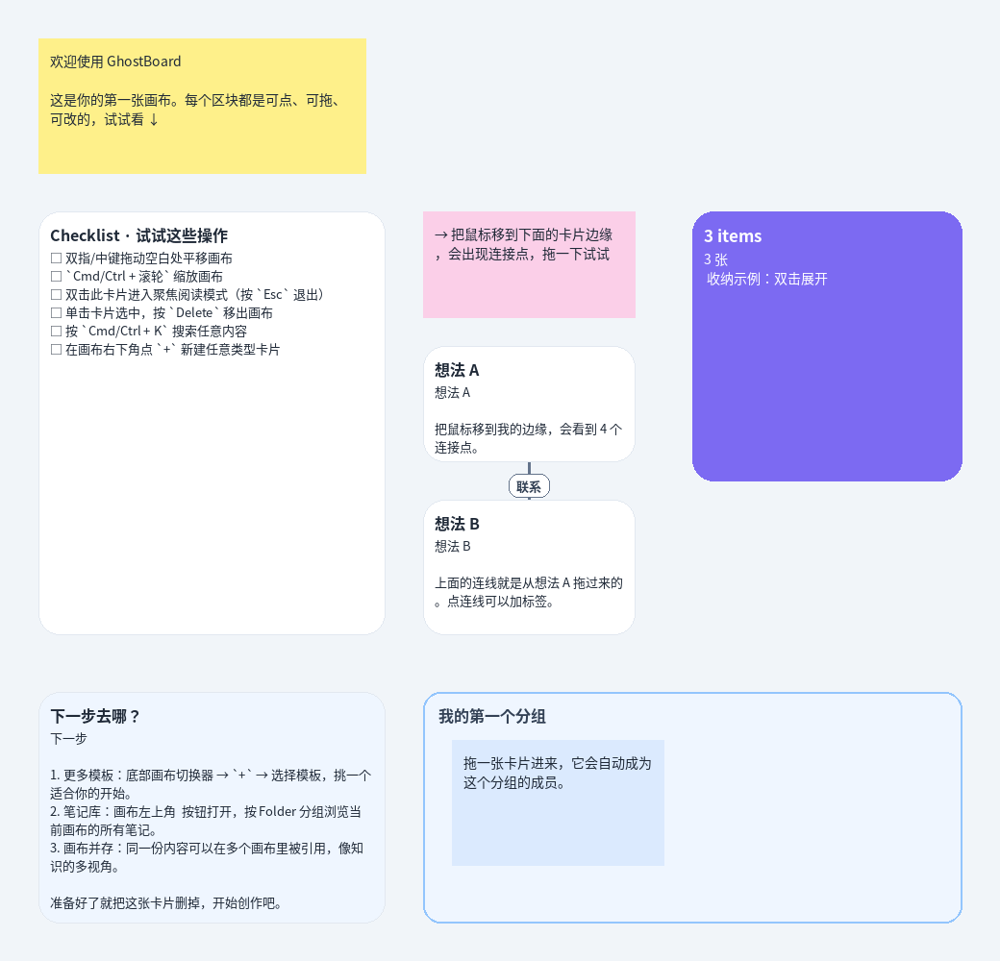
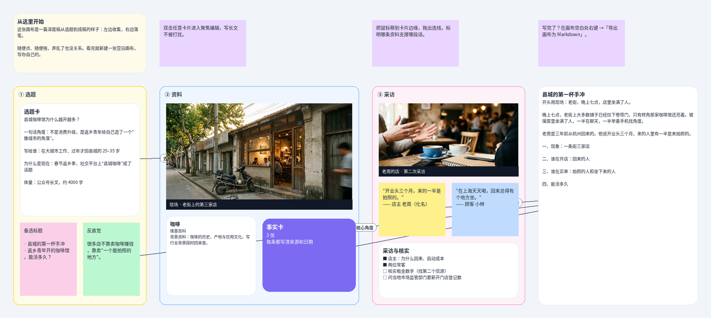
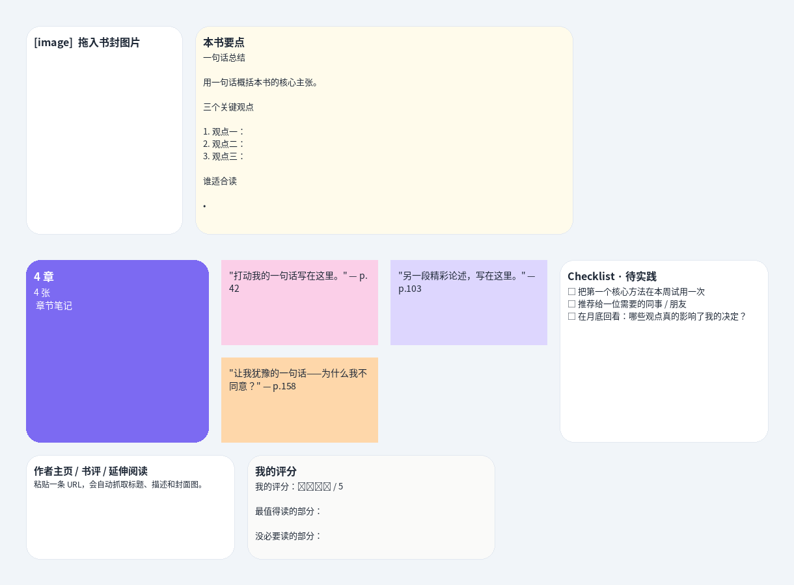
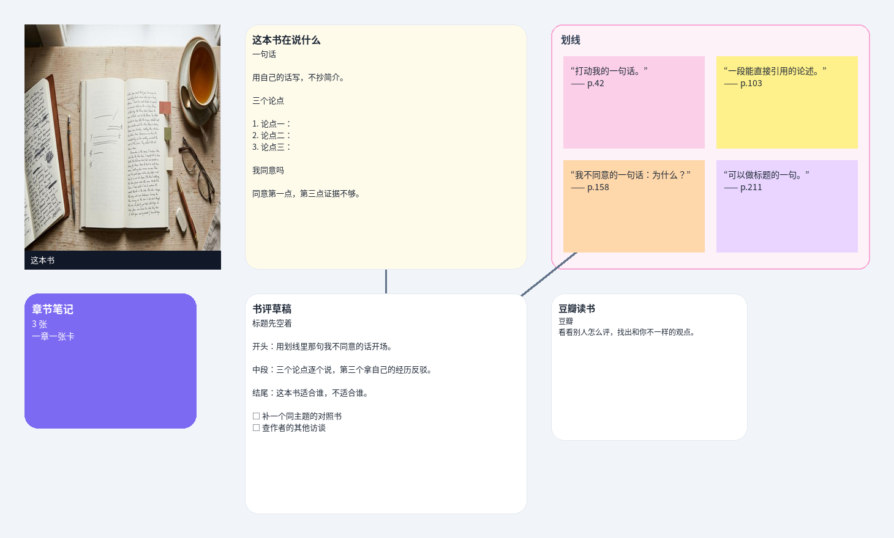
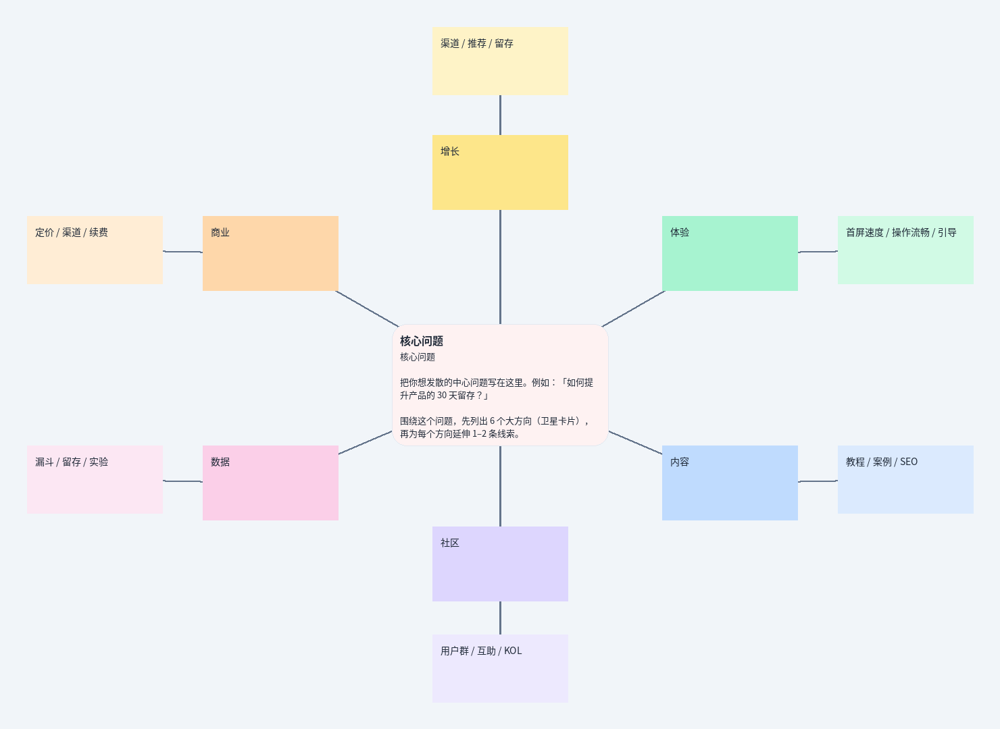
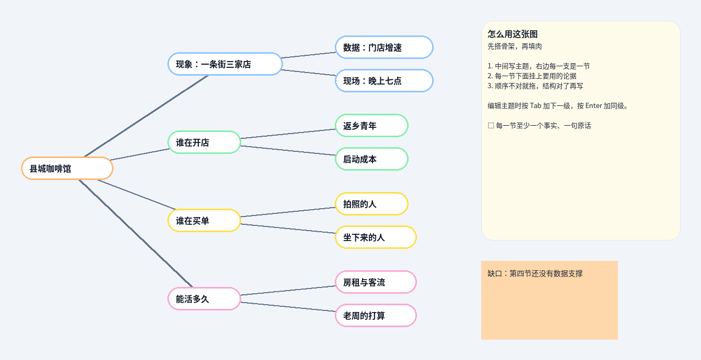
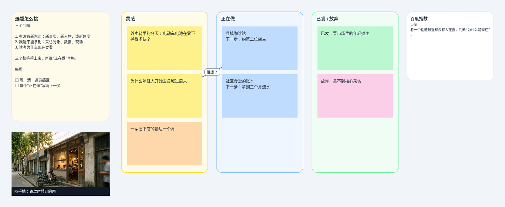
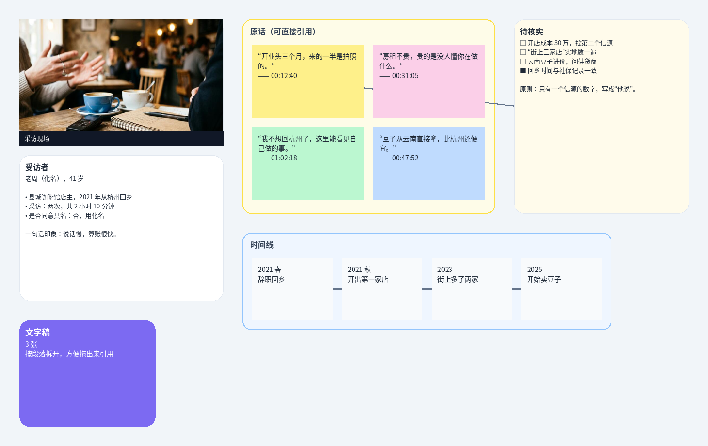
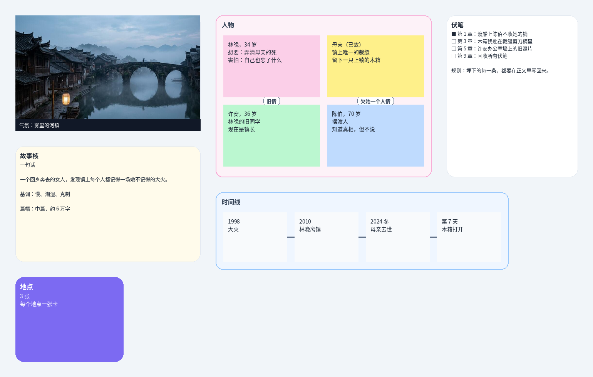
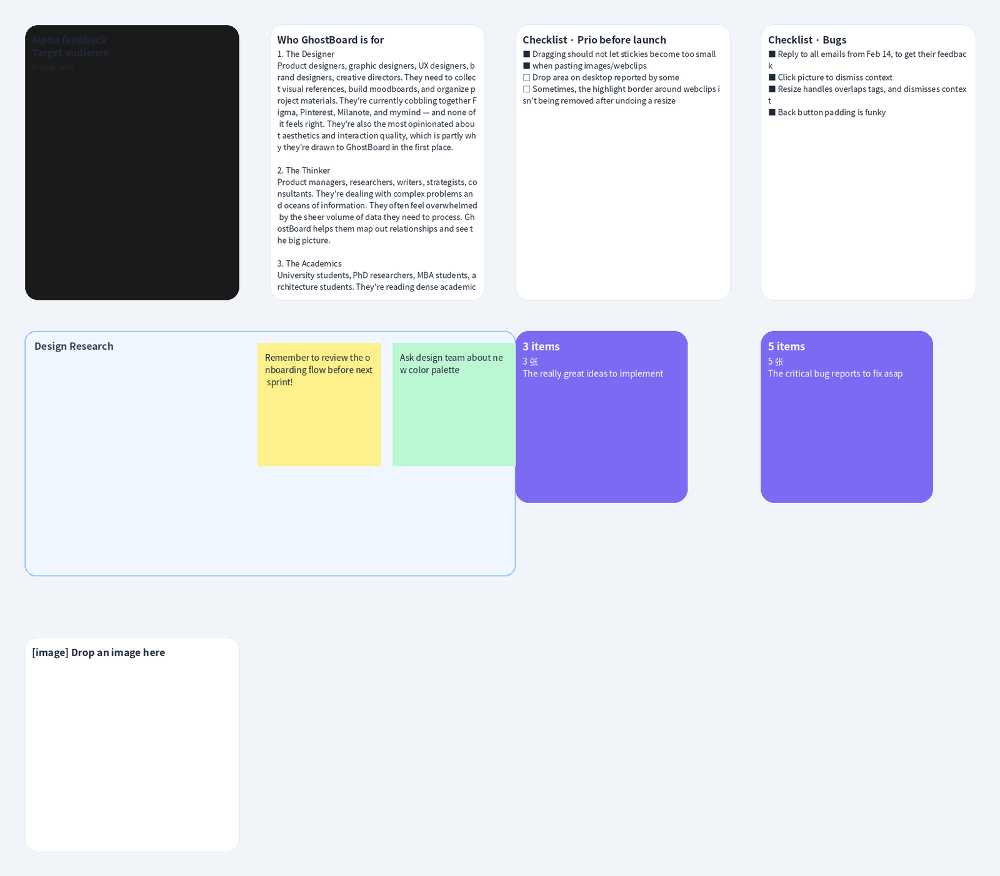

# 模板重构：改动对照（2026-11-04）

分支 `slim/v1`。对照基线是 `128301b`（资料库合并），本次改动在 `3f9000d` 和随后一次小修里。

> 图片是**线框示意**，由 `scripts/templates/render_wireframe.py` 直接从模板 JSON 画出，用来比较布局和内容，不是 App 的真实渲染。真实效果请在 Mac 上打开模板预览页查看，并用“导出缩略图”生成 `thumbnail.png`。

## 一句话

首次打开从“功能教程 + 开发者自用数据”换成“一张做完的深度稿素材板”；模板库从通用模板换成 6 个文字工作者模板；Checklist 由 Note 内任务列表替代。

## 1. 首次打开

| | 改之前 | 改之后 |
| --- | --- | --- |
| 后端种子（`workspace.ts`） | `quick-start`：功能教程，几张“想法 A / 想法 B”示范卡 | `feature-story`：一篇深度稿的完整素材板 |
| 前端兜底（`initialNodes.ts`） | 开发者自用的英文数据：“Prio before launch”“Bugs”清单、用户画像饼图 | 一张中文欢迎便签，指向模板库 |
| 教学方式 | Checklist 列出 6 条操作 | 3 张小便签贴在真实内容旁：双击聚焦、拖边缘连线、右键导出 Markdown |

**改之前（quick-start）**

**改之后（feature-story，深度稿素材板）**

## 2. 模板库

| 位置 | 改之前 | 改之后 |
| --- | --- | --- |
| 1 | 快速上手 | **深度稿素材板**（新，首次打开即为它） |
| 2 | 空白画布 | 空白画布 |
| 3 | 头脑风暴（12 张通用便签） | **选题库**（新） |
| 4 | 读书笔记（空白占位） | **采访整理**（新） |
| 5 | 演示画布 | **拆书笔记**（原读书笔记重写，id 不变：`reading-notes`） |
| 6 | — | **小说设定板**（新） |
| 7 | — | **文章结构图**（原头脑风暴重写，id 不变：`brainstorm-mindmap`，改用主题节点） |

下线（代码保留，按 id 仍可加载）：快速上手、演示画布；之前已隐藏的看板、周计划、冲刺复盘、四象限、开一家店不变。

每个新模板的标准：打开就是填满的示例，没有空卡；有照片、有连线、有分组；待办用 Note 任务列表；数字没有来源时写“待查”，不编造。

| 模板 | 节点 | 连线 | 构成 |
| --- | --- | --- | --- |
| 深度稿素材板 | 18 | 4 | 4 笔记、7 便签、3 分组、2 照片、1 链接、1 文件夹 |
| 选题库 | 13 | 1 | 1 笔记、3 分组、7 便签、1 照片、1 链接 |
| 采访整理 | 14 | 4 | 2 笔记、2 分组、8 便签、1 照片、1 文件夹 |
| 拆书笔记 | 10 | 2 | 2 笔记、1 分组、4 便签、1 照片、1 链接、1 文件夹 |
| 小说设定板 | 14 | 5 | 2 笔记、2 分组、8 便签、1 照片、1 文件夹 |
| 文章结构图 | 15 | 12 | 13 主题、1 笔记、1 便签 |

### 拆书笔记：改之前 / 改之后

### 文章结构图：改之前（头脑风暴） / 改之后

### 新模板

**选题库**

**采访整理**

**小说设定板**

### 下线的演示画布（参考）

## 3. Checklist 并入 Note

- `productScope.ts`：`HIDDEN_CREATE_CANVAS_TYPE_IDS` 加入 Checklist，新建菜单和右键菜单不再出现。
- 可见模板不再种 Checklist（`templates.test.ts` 新增断言）。
- 旧 Checklist 照常显示、编辑、搜索，没有做只读化（比原计划少一步，风险更低）。

## 4. 顺手修掉的问题

- **模板预览显示“Untitled / Empty note”**：预览直接渲染模板原始 JSON，笔记卡只有 noteId 占位；图片和链接是扩展实例，预览时不存在，显示“Preview is not available.”。新增 `src/mainview/lib/templatePreview.ts`，预览前把笔记正文、标签、图片和链接解析进节点数据。旧缩略图就是在这个问题下导出的，所以拆书笔记和文章结构图的旧 `thumbnail.png` 已删除，需要重新导出。
- 底部画布切换器的“从模板新建”快捷列表换成新的 6 个模板。

## 5. 文件清单

| 文件 | 改动 |
| --- | --- |
| `scripts/templates/build_writer_templates.py` | 新增。6 个写作模板的唯一来源，改模板就改这里再运行 |
| `scripts/templates/images/*.jpg` | 新增。4 张示例照片（AI 生成，无真实人物和文字），约 40–70 KB |
| `scripts/templates/render_wireframe.py` | 新增。画本文档里的线框图 |
| `src/bun/templates/{feature-story,topic-pool,interview-notes,novel-bible}/` | 新增模板 |
| `src/bun/templates/{reading-notes,brainstorm-mindmap}/` | 重写，id 不变 |
| `src/bun/templates.ts` | 注册新模板、调整顺序、隐藏 quick-start 和 demo |
| `src/bun/workspace.ts` | 首次打开种子改为 `feature-story` |
| `src/mainview/lib/templatePreview.ts`（含测试） | 新增，修预览 |
| `src/mainview/routes/templates/$templateId.tsx` | 预览使用上面的函数 |
| `src/mainview/data/initialNodes.ts` | 去掉开发者数据 |
| `src/mainview/lib/productScope.ts` | 隐藏新建 Checklist |
| `src/mainview/components/canvas/ViewSwitcher.tsx` | 快捷模板列表 |
| `src/mainview/hooks/useTemplates.ts`、`messages/*.json` | 新模板中英文名称和描述 |
| `docs/PRD-slim.md` | 目标用户改为中文文字工作者；§5 第 3 步标记完成 |

完整代码差异：[`code.diff`](code.diff)（不含模板 JSON 和图片），文案差异：[`messages.diff`](messages.diff)。

## 6. 验证与待办

- 已过：tsc 无项目内报错；`templates.test.ts`、`templatePreview.test.ts`、`workspace.test.ts` 共 25 个测试通过；biome 通过。
- 未做：没有在 Mac 上实际运行。
- 待你：
  1. `bun run dev:hmr`，删掉本地工作区（或换一个空目录）看首次打开的效果。
  2. 逐个打开模板预览页，点“导出缩略图”生成 6 张 `thumbnail.png`。
  3. 笔记卡高度是估的，内容如果被截断，在 `build_writer_templates.py` 里调 `h` 再运行。
